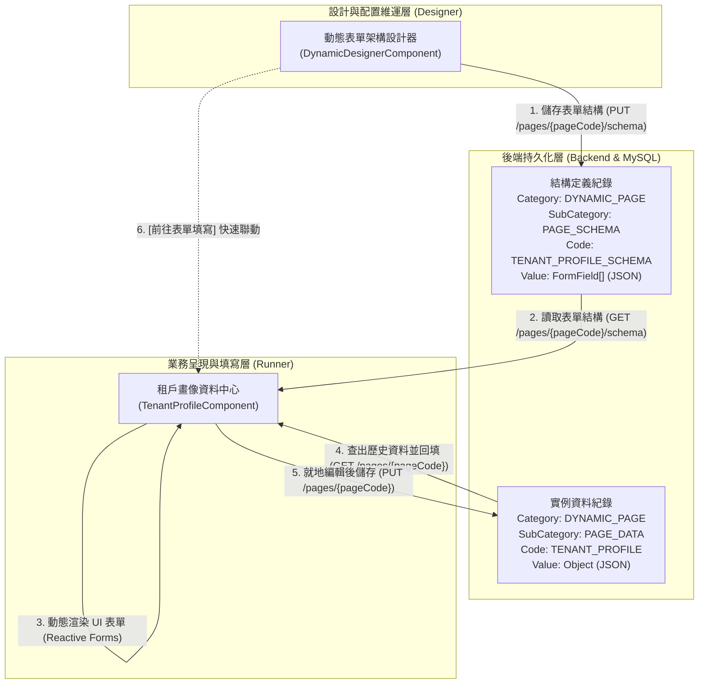

# 動態表單架構設計器與租戶自訂頁面規格書 (Dynamic Form Designer & Schema-Driven Architecture)

---

## 1. 模組設計初衷與業務背景 (Background & Motivation)

在現代多租戶（Multi-Tenancy）企業級 SaaS 與中台系統中，不同企業租戶（如：國泰世華銀行 CW、北美企業客戶 ACME）對系統畫面的業務欄位需求經常存在顯著差異：
* **傳統做法的困境**：前端將表單欄位寫死（Hardcoded），後端資料表開立大量預留欄位（`attr1`, `attr2`...）。一旦客戶需要增減欄位、改變必填規則或調整下拉選項，必須動用全端工程師修改程式碼、提 PR、執行 CI/CD 並重啟服務，開發成本高且風險巨大。
* **本模組的解決方案 (Schema-driven Dynamic UI)**：
  依循本模組核心哲學 **Function Configurable**，將「表單架構定義（Schema）」與「表單填寫資料（Data）」徹底抽象為資料庫配置：
  1. 提供視覺化的 **「動態表單架構設計器 (Dynamic Form Designer)」**，讓管理員自由定義各租戶專屬的欄位代碼、標籤、元件型態、驗證規則與顯示順序。
  2. 業務端頁面（如 **「租戶畫像資料 Tenant Profile」**）**直接依據該 Schema 在畫面上原生動態渲染出對應的 UI 元件**，並支援就地查出資料、回填編輯與保存，實現秒級即時生效（Zero Downtime）。

---

## 2. 核心架構設計與資料流 (Architecture & Data Flow)

系統採用 **雙層動態配置架構（Two-tier JSON Aggregation Pattern）**，全面落實多租戶嚴格物理/邏輯隔離：



### 兩層配置分離原則：
1. **結構定義層 (`{pageCode}_SCHEMA`)**：
   * 範例：`TENANT_PROFILE_SCHEMA`
   * 責任：描述「這個表單長什麼樣子」（有哪些欄位、型別、提示文字、驗證規則、排序）。
2. **實例資料層 (`{pageCode}`)**：
   * 範例：`TENANT_PROFILE`
   * 責任：儲存「該租戶在這個表單中實際填寫的值」（各欄位鍵值對 JSON）。

---

## 3. 四維空間定位模型 (4-Dimension Coordinate Scoping)

在 `setting-module` 的統一坐標體系中，動態表單模組被定位於 `DYNAMIC_PAGE` 維度大分類下：

| 坐標軸 (Coordinate) | 說明 | 結構定義配置 (Schema) | 業務填寫資料 (Data) |
| :--- | :--- | :--- | :--- |
| **`tenant`** | 空間隔離租戶代碼 | `CW`, `CTBC`, `ACME` 等（獨立隔離） | `CW`, `CTBC`, `ACME` 等（獨立隔離） |
| **`category`** | 功能維度大字典 | `DYNAMIC_PAGE` | `DYNAMIC_PAGE` |
| **`subCategory`** | 業務二級分類 | `PAGE_SCHEMA` | `PAGE_DATA` |
| **`code`** | 唯一業務識別碼 | `{pageCode}_SCHEMA` (例如 `TENANT_PROFILE_SCHEMA`) | `{pageCode}` (例如 `TENANT_PROFILE`) |
| **`value`** | 內容載體 (MySQL `TEXT`) | `FormField[]` 的 JSON 陣列字串 | 鍵值對形式的表單資料 JSON 字串 |

> [!IMPORTANT]
> **多租戶隔離性保證**：
> 系統中**不使用全域 `tenant = 'ALL'`**。租戶 `CW` 修改其 `TENANT_PROFILE_SCHEMA` 增加新欄位，僅會對租戶 `CW` 生效，其他租戶（如 `ACME`）之結構與資料完全獨立，互不干擾。

---

## 4. 欄位模型定義規格 (FormField Specification)

前端與後端交換的欄位定義陣列遵循 TypeScript 模型 `FormField`：

```typescript
export interface FormField {
  name: string;                   // 欄位英文識別碼 (對應 FormGroup 鍵值，如 tenantCode)
  label: string;                  // 畫面展示中文標籤 (如 租戶識別代碼)
  type: FormFieldType;            // 元件渲染型別
  validators: string[];           // 驗證規則陣列 (支援 'required', 'email')
  placeholder?: string;           // 輸入提示文字 (Placeholder)
  options?: FormFieldOption[];    // 下拉選單專用選項清單 [{ label, value }]
  pattern?: string;               // 日期/字串正則格式 (如 'yy-mm-dd')
  rows?: number;                  // 多行文字框列數 (Textarea 専用)
  cols?: number;                  // 多行文字框行數 (Textarea 専用)
  uri?: string;                   // 自動建議 AutoComplete 遠端檢索資源標識
}

export type FormFieldType =
  | 'text'          // 單行文字輸入 (pInputText)
  | 'number'        // 數值輸入框 (pInputNumber)
  | 'email'         // 電子信箱 (pInputText + Email 檢核)
  | 'time'          // 時間輸入 (Time)
  | 'dropdown'      // 下拉選單 (pDropdown)
  | 'calendar'      // 日曆日期選擇器 (pCalendar)
  | 'autocomplete'  // 遠端自動完成建議 (pAutoComplete)
  | 'textarea';     // 多行備註文字框 (pInputTextarea)
```

### JSON 結構範例 (TENANT_PROFILE_SCHEMA)：
```json
[
  {
    "name": "tenantName",
    "type": "text",
    "label": "租戶正式名稱",
    "validators": ["required"],
    "placeholder": "請輸入租戶企業名稱"
  },
  {
    "name": "tenantCode",
    "type": "text",
    "label": "租戶識別代碼",
    "validators": ["required"],
    "placeholder": "例如: CW, ACME"
  },
  {
    "name": "contactEmail",
    "type": "email",
    "label": "系統管理員聯絡信箱",
    "validators": ["required", "email"],
    "placeholder": "admin@example.com"
  },
  {
    "name": "tier",
    "type": "dropdown",
    "label": "租戶合約等級方案",
    "validators": ["required"],
    "options": [
      { "label": "標準版 (Standard)", "value": "STANDARD" },
      { "label": "企業版 (Enterprise)", "value": "ENTERPRISE" },
      { "label": "旗艦版 (Ultimate)", "value": "ULTIMATE" }
    ],
    "placeholder": "請選擇等級方案"
  },
  {
    "name": "contractExpiry",
    "type": "calendar",
    "label": "授權合約到期日",
    "validators": ["required"],
    "pattern": "yy-mm-dd",
    "placeholder": "yy-mm-dd"
  },
  {
    "name": "dataRegion",
    "type": "autocomplete",
    "label": "數據隔離託管區域",
    "validators": [],
    "placeholder": "搜尋或輸入資料中心區域 (如: 台北, 東京, 美西)",
    "uri": "regions"
  }
]
```

---

## 5. 後端 RESTful API 規格 (REST API Contracts)

後端集中於 [SettingController.java](file:///d:/桌面/ModuleWorkSpace/setting-module/backend/src/main/java/com/module/setting/presentation/controller/SettingController.java) 提供標準 REST API：

### 1. 取得指定租戶之表單結構定義 (Schema)
* **Method & Path**：`GET /api/v1/settings/pages/{pageCode}/schema`
* **Query Parameters**：
  * `tenant`（可選）：指定租戶代碼，若無則由 `UserContextFilter` 穿透之 `X-Tenant-Id` 解析，預設為 `CW`。
* **內部邏輯**：向後端查詢 `(tenant, "DYNAMIC_PAGE", pageCode + "_SCHEMA")` 紀錄。
* **回應 (200 OK)**：
  ```json
  {
    "id": 30,
    "tenant": "CW",
    "category": "DYNAMIC_PAGE",
    "subCategory": "PAGE_SCHEMA",
    "code": "TENANT_PROFILE_SCHEMA",
    "name": "TENANT_PROFILE Schema",
    "value": "[{\"name\":\"tenantName\",\"type\":\"text\",\"label\":\"租戶正式名稱\",...}]",
    "priorityNo": 1,
    "activeFlag": "Y"
  }
  ```

### 2. 儲存或更新指定租戶之表單結構定義 (Schema)
* **Method & Path**：`PUT /api/v1/settings/pages/{pageCode}/schema`
* **Query Parameters**：`tenant`（可選）
* **Request Body**：`FormField[]` JSON 字串陣列
* **回應 (200 OK)**：回傳儲存更新後之 `SettingGottenResource` 物件。

### 3. 取得指定租戶之表單填寫資料 (Data)
* **Method & Path**：`GET /api/v1/settings/pages/{pageCode}`
* **Query Parameters**：`tenant`（可選）
* **回應 (200 OK)**：
  ```json
  {
    "id": 31,
    "tenant": "CW",
    "category": "DYNAMIC_PAGE",
    "subCategory": "PAGE_DATA",
    "code": "TENANT_PROFILE",
    "name": "TENANT_PROFILE",
    "value": "{\"tenantName\":\"國泰世華銀行總行\",\"tenantCode\":\"CW\",\"contactEmail\":\"admin@cw.com\",\"maxUsers\":500,\"tier\":\"ENTERPRISE\",\"contractExpiry\":\"2027-12-31\",\"dataRegion\":\"TW-TPE-1\"}",
    "priorityNo": 1,
    "activeFlag": "Y"
  }
  ```

### 4. 儲存或更新指定租戶之表單填寫資料 (Data)
* **Method & Path**：`PUT /api/v1/settings/pages/{pageCode}`
* **Query Parameters**：`tenant`（可選）
* **Request Body**：表單實例資料之 JSON 鍵值對字串
* **回應 (200 OK)**：回傳儲存更新後之 `SettingGottenResource` 物件。

---

## 6. 前端架構與使用者互動體驗 (Frontend Architecture)

前端由三大模組元件組成，完全符合 Angular 18 獨立元件（Standalone Components）與 Reactive Forms 設計：

### 1. 動態表單架構設計器 (`DynamicDesignerComponent`)
* **檔案位址**：[dynamic-designer.component.ts](file:///d:/桌面/ModuleWorkSpace/setting-module/frontend/src/app/features/dynamic-page/components/dynamic-designer/dynamic-designer.component.ts)
* **主要職能**：
  * **頁面維護選擇器**：支援隨時切換 `TENANT_PROFILE`、`USER_ONBOARDING` 等自訂頁面代碼，亦可「+ 新增自訂頁面」。
  * **視覺化欄位列表**：以 PrimeNG Table 展示當前配置之所有欄位。
  * **即時拖拉與上下排序**：提供 `↑` 上移與 `↓` 下移操作，即時調整欄位在最終表單的呈現次序。
  * **欄位定義彈窗 (Field Dialog)**：支援新增與編輯各型態欄位，動態切換 Dropdown 選項設定、日曆格式設定或 AutoComplete 資源設定。
  * **即時 Schema Inspector (可收合)**：底部提供深色代碼檢視器，點擊標題即可自由展開/收合 JSON 結構。
  * **一鍵跳轉**：右上角「👁️ 前往表單填寫」一鍵直接切換至該表單填寫介面。

### 2. 租戶畫像資料中心 (`TenantProfileComponent`)
* **檔案位址**：[tenant-profile.component.ts](file:///d:/桌面/ModuleWorkSpace/setting-module/frontend/src/app/features/tenant-profile/components/tenant-profile/tenant-profile.component.ts)
* **主要職能**：
  * **原生 Schema 驅動渲染**：**直接將設計器所定義之 UI 表單長在頁面上**，無多餘的清單表格或彈窗跳出，提供直覺的表單填寫體驗。
  * **查出回填編輯 (In-place Query & Edit)**：
    * 進入頁面時，自動向後端查出當前租戶現存畫像資料，直接回填至表單欄位。
    * 頂部提供「查出指定租戶畫像資料 (Tenant Code)」快捷工具列，支援切換租戶代碼後點擊「查出資料」即刻重新載入。
  * **就地保存與驗證**：使用者直接於頁面修改任一欄位後，點選「💾 儲存畫像設定」，通過 Angular Reactive Validator 檢驗後即時寫入後端。
  * **隨時還原與開新**：支援「🔄 還原查出值」恢復初始數值，或「✨ 開新填寫」清空欄位錄入新租戶。
  * **設計器無縫聯動**：點擊「✏️ 自訂表單設計 (Designer)」可隨時折返設計器增減欄位，儲存後即刻在畫像頁面動態長出新元件！

### 3. 前端通訊服務 (`DynamicPageService`)
* **檔案位址**：[dynamic-page.service.ts](file:///d:/桌面/ModuleWorkSpace/setting-module/frontend/src/app/features/dynamic-page/services/dynamic-page.service.ts)
* **主要職能**：
  * 封裝所有 Schema 與 Data 的 HTTP 呼叫。
  * **自動容錯與代碼正規化**：自動處理 `_SCHEMA` 後綴，避免重複拼接導致查詢無效。
  * 內建開箱即用的 `getDefaultSchema()` 備援範本。
  * 支援 AutoComplete 遠端關鍵字模糊檢索建議。

---

## 7. 系統自我修復與平滑相容機制 (Self-Healing & Resilience)

1. **MySQL 儲存容量升級**：
   * 實體 [Setting.java](file:///d:/桌面/ModuleWorkSpace/setting-module/backend/src/main/java/com/module/setting/infrastructure/persistence/setting/entity/Setting.java) 將 `value` 欄位宣告為 `@Column(name = "value", columnDefinition = "TEXT")`，避免龐大 JSON Schema 引發 `Data truncation: Data too long for column 'value'` 錯誤。
2. **側邊導航選單自動補齊 (Self-Healing Initializer)**：
   * 在 [SettingDataInitializer.java](file:///d:/桌面/ModuleWorkSpace/setting-module/backend/src/main/java/com/module/setting/config/init/SettingDataInitializer.java) 中加入自動修補機制：系統啟動時若發現既有 DB 資料缺乏 `"view"` 屬性，或舊名稱仍為「租戶隔離中心」，自動自我修復補上 `"view":"tenant-profile"` 並統一名稱為「租戶畫像資料」。
   * 前端 [menu.service.ts](file:///d:/桌面/ModuleWorkSpace/setting-module/frontend/src/app/core/services/menu.service.ts) 與 [sidebar.component.ts](file:///d:/桌面/ModuleWorkSpace/setting-module/frontend/src/app/core/components/sidebar/sidebar.component.ts) 雙重保險：即使 DB 讀取失敗，硬編碼 Fallback 亦保證 100% 導航至正確元件。
3. **按鈕與全域排版樣式防禦**：
   * 在 [styles.scss](file:///d:/桌面/ModuleWorkSpace/setting-module/frontend/src/styles.scss) 徹底規範 `.p-button-text` 避免實心藍色底色污染。
   * 全面規範 `.row-actions` 與 `.action-btn` 統一規格（28px × 28px），維持最高水準之企業級視覺美感。

---

## 8. 維運常見操作指引 (Operational Playbook)

### 情境 A：為租戶 CW 在租戶畫像表單中新增一個自訂欄位「統一編號 (taxId)」
1. 點擊側邊欄 **「動態表單設計」** ✏️。
2. 確認上方「頁面識別」為 `TENANT_PROFILE`，點擊右上角 **`+ 新增自訂欄位`**。
3. 填入：
   * 英文代碼：`taxId`
   * 標籤名稱：`企業統一編號`
   * 元件類型：`單行文字 (Text)`
   * 驗證規則：勾選 `必填 (Required)`
   * 提示文字：`例如: 12345678`
4. 點擊彈窗中的「確認儲存」。
5. 在欄位清單中可使用 `↑` / `↓` 調整其顯示位置。
6. 點擊右上角 **`💾 儲存設計 Schema`**（彈出儲存成功 Toast）。
7. 點擊右上角 **`👁️ 前往表單填寫`** ➔ 系統立即跳轉至「租戶畫像資料」，畫面中央直接出現剛剛新增的「企業統一編號」輸入框，且具備必填星號！

### 情境 B：查閱並修改另一個租戶 (如 ACME) 的畫像資料
1. 點擊側邊欄 **「租戶畫像資料」** 🏢。
2. 在頂部「查出指定租戶畫像資料」輸入框中輸入或選擇 `ACME`。
3. 點擊 **`[ 🔍 查出資料 ]`**。
4. 表單欄位立即從後端查出 ACME 的資料並自動回填於畫面中。
5. 直接於各欄位修改數值後，點擊底部 **`[ 💾 儲存畫像設定 ]`** 即可完成更新！
