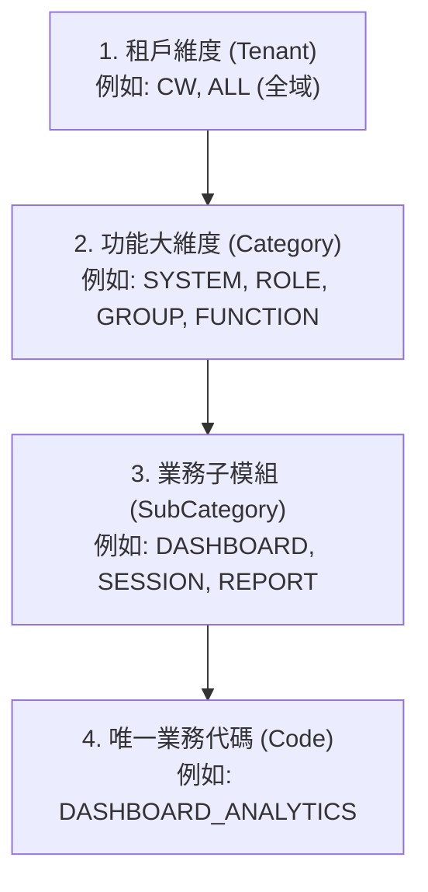

# 核心概念架構白皮書 (Architecture Concept & Whitepaper)
## 模組核心理念：Function Configurable (功能與參數動態配置)

---

### 1. 什麼是 Function Configurable？(Definition & Essence)

**Function Configurable（功能與參數動態配置）** 是一種現代化企業級微服務架構的設計模式與能力體系：

> **核心定義**：  
> 將全系統中所有的**「業務功能開關（Feature Flags）」**、**「運行參數與閾值（Runtime Parameters）」**、**「頁面路由與端點（Dynamic Routes）」**與**「組織/角色策略（Role & Scope Policies）」**，從傳統的**「硬編碼（Hardcode）」**或**「重啟才能生效的靜態設定檔（如 `application.yml`, `.properties`）」**中徹底解耦，轉化為**「可在執行時期（Runtime）由維運或業務人員透過視覺化介面即時調整、即時生效，且具備多租戶隔離性」**的通用標準化配置服務。

在 `setting-module` 中，本模組被明確定義為：
**「底層共用功能配置模組 (Foundational Function Configurable Module)」**。

---

### 2. 為什麼需要 Function Configurable？(Pain Points & Advantages)

在傳統系統開發中，功能設定往往面臨以下四大痛點：

```
[傳統模式痛點]
  ├── 1. 調整業務參數或功能上線，必須修改程式碼或 yml -> 重新編譯、打包部署、重啟微服務 (高風險、高耗時)
  ├── 2. 缺乏多租戶隔離，針對不同客戶/租戶的客製化邏輯充斥大量的 if (tenant == 'CW') 程式碼分支
  ├── 3. 各微服務重複造輪子，各自建立 sys_config, app_param 資料表，欄位定義紊亂且無統一管理介面
  └── 4. 字典與設定混雜，造成大分類選單冷啟動空白、資料表污染與二級聯動邏輯混亂
```

透過本模組提供的 **Function Configurable** 機制，帶來了質的轉變：

| 評估維度 | 傳統做法（非 Configurable） | Function Configurable（本模組做法） |
| :--- | :--- | :--- |
| **變更生效時間** | 數小時至數天（需提 PR、跑 CI/CD、維護窗口重啟） | **秒級即時生效（Zero Downtime，免重啟系統）** |
| **部署成本與風險** | 高。每次調整參數都要重新發版，容易引發服務震盪 | **極低。單純資料異動，零發版風險** |
| **多租戶自適應** | 需透過程式碼硬寫客製邏輯，維護成本極高 | **天然具備 `tenant` 空間隔離，各租戶配置獨立互不干擾** |
| **微服務架構標準** | 各團隊各自為政，重複開發設定資料庫與管理頁面 | **全企業共用單一標準化底座，各業務微服務開箱即用** |
| **權限與審計** | 依賴資料庫直接下 SQL Update，缺乏審計日誌與安全驗證 | **提供標準 RESTful API 與前後端防護，具備完整欄位驗證與操作稽核** |

---

### 3. 四維空間定位模型 (4-Dimension Coordinate Scoping)

在 `setting-module` 中，任何一項業務功能或參數項目，皆抽象為 **`SettingScope`** 四維空間坐標進行唯一識別與定位：



#### 坐標軸詳細定義：
1. **`tenant`（空間隔離軸）**：
   * 標識所屬企業客戶或租戶（例如固定為 `CW`，全域共用則為 `ALL`）。
   * 確保同一個業務功能在不同租戶下可配置完全相異的數值或開關狀態。
2. **`category`（業務大維度軸）**：
   * 參照獨立元資料字典 `setting_category` 表的代碼（如 `SYSTEM` 系統底層、`ROLE` 角色配置、`GROUP` 組織群組、`FUNCTION` 功能節點）。
   * 將全系統的設定依架構層級進行頂層分類。
3. **`subCategory`（業務子模組軸）**：
   * 將大維度進一步細分至具體的業務模組或場景（例如 `DASHBOARD` 儀表板、`SESSION` 會話控制、`REPORT` 報表模組）。
   * 支援手動自由擴充，提供前端二級聯動選單。
4. **`code`（唯一業務鍵軸）**：
   * 在 `(tenant, category)` 範疇下的唯一大寫英數字鍵值（如 `SERVER_PORT`, `MAX_SESSIONS`, `DASHBOARD_ANALYTICS`）。

---

### 4. 四大核心應用場景 (Core Use Cases)

#### 4.1 功能特性開關 (Feature Flags / Toggles)
* **場景**：灰度發布（Canary Release）、新功能上線、付費模組解鎖。
* **範例**：
  * `category` = `FUNCTION`
  * `subCategory` = `DASHBOARD`
  * `code` = `DASHBOARD_ANALYTICS`
  * `value` = `"true"`（啟用）/ `"false"`（停用）
* **效果**：前端直接根據 API 返回值動態決定是否渲染「數據分析」圖表；後端亦可在 Controller/UseCase 層攔截未開通的請求。

#### 4.2 執行時期運行參數與閾值 (Runtime Parameters & Thresholds)
* **場景**：效能調優、頻率限制、連線逾時。
* **範例**：
  * `category` = `SYSTEM`
  * `subCategory` = `SESSION`
  * `code` = `SESSION_TIMEOUT_SECONDS`
  * `value` = `"1800"`
* **效果**：當維運人員發現伺服器記憶體吃緊時，可隨時在後台將會話逾時縮短至 `900` 秒，系統立即依新參數運行，無須重啟。

#### 4.3 動態路由與外部服務介面 (Dynamic Routing & Endpoints)
* **場景**：API Gateway 路由、第三方金流/簡訊平台網址切換、測試/生產環境端點切換。
* **範例**：
  * `category` = `SYSTEM`
  * `subCategory` = `AUTH`
  * `code` = `SSO_LOGIN_ENDPOINT`
  * `value` = `"https://sso.cw.com/oauth2/authorize"`
* **效果**：網址異動或憑證替換時，一鍵更新即刻生效。

#### 4.4 前端動態選單與字典選單來源 (Dynamic UI Options & Catalogs)
* **場景**：下拉選單（Dropdown Options）、頁面按鈕清單、階層導覽樹。
* **範例**：
  * 後端透過 `/api/v1/settings/categories/{cat}/sub-categories` 端點，回傳具有 `label` 與 `value` 的即時選項清單。
  * 配合 `priorityNo` 嚴格控制前後端清單顯示先後順序，配合 `activeFlag` 隨時隱藏下線模組。

---

### 5. 雙實體解耦與純淨初始化架構 (Decoupled & Zero-Pollution)

為了達成高內聚低耦合的架構品質，本模組嚴格落實兩項架構原則：

```
[setting_category 表] ── 1. 定義大維度 ──> (SYSTEM, ROLE, GROUP, FUNCTION)
                                                 │
                                         2. 坐標約束 (scope.category)
                                                 ▼
[setting 表]          ── 3. 儲存具體參數 ─> (SERVER_PORT, DASHBOARD_ANALYTICS...)
```

1. **實體徹底解耦**：
   * **`SettingCategory` 實體**：專門負責全系統「維度字典定義」，擁有自定義中文名稱與排序。
   * **`Setting` 實體**：專門負責「具體功能設定」，其 `category` 坐標關聯至字典代碼。
   * **徹底廢除過往將 `META` 假資料插入 `setting` 表的自舉模式**，消除選單錯亂與資料污染。
2. **零污染基準線 (Zero-Pollution Baseline)**：
   * 系統啟動時，`setting_category` 表僅初始化一筆全域基礎設施維度：`SYSTEM`（系統配置）。
   * `setting` 業務設定表初始化嚴格維持 **0 筆**，不注入任何假設性的假資料。
   * 其餘所有業務維度與具體設定項目，均由維運人員依照作業手冊（參閱 [manual-setting-configuration-guide.md](file:///d:/桌面/ModuleWorkSpace/setting-module/doc/guide/manual-setting-configuration-guide.md)）或自動化腳本手動建立。

---

### 6. 前後端架構串接與上下文穿透 (Context Propagation)

本模組透過上下文穿透技術，保證無論前端如何操作，後端皆能自動識別並隔離租戶與使用者：

```mermaid
sequenceDiagram
    participant User as 瀏覽器 / 前端 (Angular)
    participant Interceptor as tenantInterceptor (Core)
    participant Filter as UserContextFilter (Spring Boot)
    participant Holder as UserContextHolder (ThreadLocal)
    participant Service as SettingApplicationService

    User->>Interceptor: 發起 HTTP API 請求
    Note over Interceptor: 自動注入 X-Tenant-Id: CW<br/>自動注入 X-Username: nickgh.zhang@cw.com
    Interceptor->>Filter: 傳遞包含 Header 的 Request
    Filter->>Holder: 解析並設置 Tenant 與 Username
    Filter->>Service: 呼叫業務用例 (UseCase)
    Service->>Holder: 依據 Context 自動取得租戶執行業務
    Service-->>Filter: 回傳結果
    Note over Filter: finally { UserContextHolder.clear(); }
    Filter-->>User: 回傳 200/201 JSON Response
```

---

### 7. 總結

**Function Configurable 模組不僅僅是一個「參數資料表」，而是整個微服務生態系的「功能神經中樞」**。  
它賦予系統在不停機的情況下自我演化、動態開關業務功能的能力，是高可用性（High Availability）、多租戶架構（Multi-Tenancy）與持續交付（Continuous Delivery）不可或缺的基礎設施基石。
