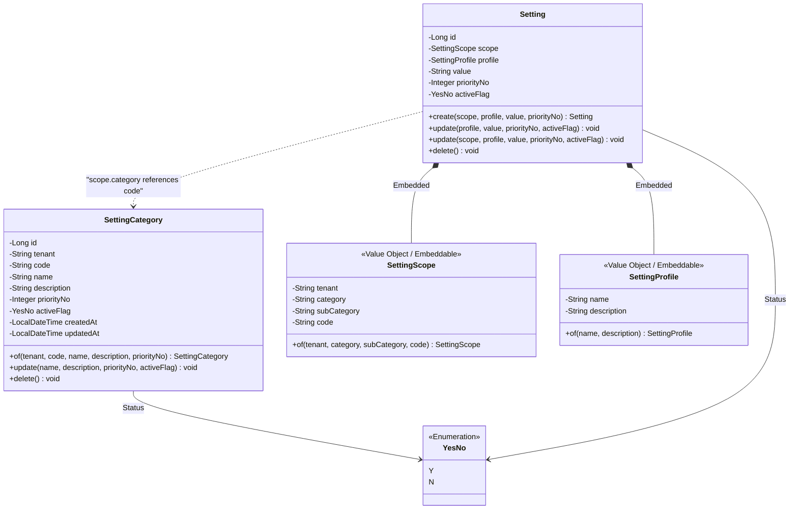
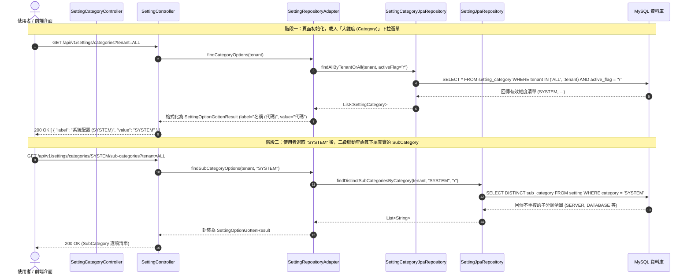

# 系統設計規格書 (System Architecture & Design Specification)
## 模組名稱：Setting Module - 通用配置與元資料字典架構全景設計 (Unified Architecture SD)

---

### 1. 文件資訊 (Document Metadata)
* **專案名稱**：`setting-module`
* **模組定位**：底層共用功能配置模組 (Foundational Function Configurable Module)
* **架構風格**：Clean Architecture / 六角形架構 (Ports & Adapters)
* **文件版本**：v2.0.0 (Unified & Decoupled)
* **狀態**：Approved & Implemented
* **整併說明**：本文件完整整併並取代原分立之 `setting-entity-sd.md`、`setting-initialization-sd.md` 與舊版 `setting-metadata-architecture-sd.md`，消除重複與過時定義，作為本模組唯一的權威架構規格書 (Single Source of Truth)。

---

### 2. 業務背景與架構演進 (Business Background & Evolution)

#### 2.1 業務背景
本模組旨在為企業級多微服務系統提供統一、靈活且通用的 **「Function Configurable（功能與參數動態配置）」** 能力。
系統中的系統參數 (`SYSTEM`)、業務角色 (`ROLE`)、組織群組 (`GROUP`)、功能節點 (`FUNCTION`) 及各項業務開關，皆能透過統一的多維坐標模型進行抽象與管理，免去各業務微服務重複建立配置資料表的繁瑣工作。

#### 2.2 架構痛點與演進歷程
在模組發展歷程中，針對「大分類下拉選單（Category Dropdown）」經歷了三個演進階段：

```
[階段 1: 傳統 SELECT DISTINCT]
  └── 缺點：無中文名稱、無法自訂排序、資料庫全新時選單空白（冷啟動失效）。
       │
       ▼
[階段 2: 單表 META 自舉 (舊版設計，已廢除)]
  └── 缺點：在 setting 表中插入 category='META' 記錄。
           導致業務設定與字典混雜、二級聯動邏輯混亂、前端選單資料不一致。
       │
       ▼
[階段 3: 維度字典徹底解耦 (現行 v2.0.0 架構)]
  └── 成功解耦為兩層架構：
      1. SettingCategory 實體 (`setting_category` 表)：專門存放全系統大維度字典。
      2. Setting 實體 (`setting` 表)：專門存放具體業務設定，其坐標參照維度字典。
```

#### 2.3 純淨無污染與手動配置原則 (Zero-Pollution Baseline)
* **除 `SYSTEM` 基礎骨幹維度外，系統預設不再自動初始化任何非必要之假資料**。
* `setting_category` 資料表於系統啟動時僅寫入一筆 `SYSTEM`（系統配置）基礎設施維度。
* `setting` 業務設定表初始化預設為 **0 筆**資料，杜絕環境充斥非預期的預設假資料。
* 其餘業務維度（如 `ROLE`, `GROUP`, `FUNCTION`）及具體業務設定項目，全數交由維運人員依據標準作業手冊（參閱 [manual-setting-configuration-guide.md](file:///d:/桌面/ModuleWorkSpace/setting-module/doc/guide/manual-setting-configuration-guide.md)）於管理後台或透過 RESTful API 手動配置。

---

### 3. 領域模型與實體類別圖 (Domain Models & Class Diagram)



#### 3.1 實體與值物件職責定義
1. **`SettingCategory`（維度元資料實體）**：
   * **完整路徑**：`com.module.setting.infrastructure.persistence.category.entity.SettingCategory`
   * **職責**：代表全系統大分類維度（如 `SYSTEM`, `ROLE`, `GROUP`, `FUNCTION`）的定義，具備中英文名稱、租戶屬性、排序序號與有效狀態。
2. **`Setting`（功能設定核心實體）**：
   * **完整路徑**：`com.module.setting.infrastructure.persistence.setting.entity.Setting`
   * **職責**：代表具體的業務設定項目，透過 `SettingScope` 與 `SettingProfile` 實現高內聚。
3. **`SettingScope`（多維定位坐標 Value Object）**：
   * 封裝四維定位坐標：`tenant`（空間隔離）、`category`（參照 `SettingCategory.code`）、`subCategory`（子模組/子分類）、`code`（唯一設定代碼）。
4. **`SettingProfile`（展示屬性 Value Object）**：
   * 封裝 `name`（顯示名稱 / 前端下拉 Label）與 `description`（用途說明）。
5. **`YesNo`（狀態枚舉）**：
   * `Y`（有效 / 啟用）、`N`（邏輯刪除 / 停用）。

---

### 4. 資料字典與資料庫 Schema (Data Dictionary & DDL)

#### 4.1 維度字典表 (`setting_category`)

| 欄位名 | 資料型別 (DB) | 空值限制 | 預設值 | 業務意義與用途說明 | 範例資料 |
| :--- | :--- | :--- | :--- | :--- | :--- |
| `id` | `BIGINT` | `NOT NULL` | Auto-Inc | 主鍵流水號 | `1` |
| `tenant` | `VARCHAR(64)` | `NOT NULL` | `'ALL'` | 租戶識別碼（`ALL` 為全域共用） | `ALL`, `T001` |
| `code` | `VARCHAR(64)` | `NOT NULL` | - | 維度唯一代碼（大寫英數字） | `SYSTEM`, `ROLE` |
| `name` | `VARCHAR(128)`| `NOT NULL` | - | 維度中文顯示名稱 | `系統配置`, `角色配置` |
| `description` | `VARCHAR(512)`| `NULL` | - | 維度業務範疇與說明 | `系統底層與全域基礎設施配置` |
| `priority_no` | `INT` | `NOT NULL` | `1` | 排序優先序號 (升冪) | `1`, `2` |
| `active_flag` | `VARCHAR(1)` | `NOT NULL` | `'Y'` | 狀態旗標：`Y` (有效), `N` (停用) | `Y`, `N` |
| `created_at` | `DATETIME` | `NOT NULL` | CURRENT_TIMESTAMP | 建立時間戳記 | `2026-11-15 12:00:00` |
| `updated_at` | `DATETIME` | `NOT NULL` | CURRENT_TIMESTAMP | 更新時間戳記 | `2026-11-15 12:00:00` |

#### 4.2 功能設定表 (`setting`)

| 欄位名 | 資料型別 (DB) | 空值限制 | 預設值 | 業務意義與用途說明 | 範例資料 |
| :--- | :--- | :--- | :--- | :--- | :--- |
| `id` | `BIGINT` | `NOT NULL` | Auto-Inc | 主鍵識別流水號 | `1` |
| `tenant` | `VARCHAR(50)` | `NOT NULL` | - | 租戶代碼，用於多租戶隔離 | `ALL`, `T001` |
| `category` | `VARCHAR(50)` | `NOT NULL` | - | 業務維度（對應 `setting_category.code`） | `SYSTEM`, `ROLE` |
| `sub_category`| `VARCHAR(50)` | `NULL` | - | 業務子分類 / 模組類型 | `SERVER`, `DATABASE` |
| `code` | `VARCHAR(100)`| `NOT NULL` | - | 設定唯一代碼識別鍵 | `SERVER_PORT`, `MAX_SESSIONS`|
| `name` | `VARCHAR(100)`| `NULL` | - | 設定顯示標籤 (前端 Label) | `服務監聽連接埠` |
| `description` | `VARCHAR(255)`| `NULL` | - | 設定詳細說明、備註 | `後端微服務 HTTP 監聽埠號` |
| `value` | `VARCHAR(500)`| `NULL` | - | 具體配置值、字串或參數 | `8080`, `100` |
| `priority_no` | `INT` | `NULL` | `1` | 順序號，控制清單排序 | `1`, `2`, `3` |
| `active_flag` | `VARCHAR(1)` | `NOT NULL` | `'Y'` | 狀態旗標：`Y` (有效), `N` (停用/刪除) | `Y`, `N` |

#### 4.3 資料庫 DDL 與索引策略

```sql
-- 1. 維度字典表：存放大維度元資料
CREATE TABLE IF NOT EXISTS setting_category (
    id BIGINT AUTO_INCREMENT PRIMARY KEY COMMENT '主鍵流水號',
    tenant VARCHAR(64) NOT NULL DEFAULT 'ALL' COMMENT '租戶識別代碼 (ALL 為全域共用)',
    code VARCHAR(64) NOT NULL COMMENT '維度唯一代碼 (如 SYSTEM, ROLE, GROUP, FUNCTION)',
    name VARCHAR(128) NOT NULL COMMENT '維度中文名稱 (前端 Label)',
    description VARCHAR(512) NULL COMMENT '維度備註說明',
    priority_no INT NOT NULL DEFAULT 1 COMMENT '排序序號',
    active_flag VARCHAR(1) NOT NULL DEFAULT 'Y' COMMENT '有效狀態 (Y: 有效, N: 停用)',
    created_at DATETIME NOT NULL DEFAULT CURRENT_TIMESTAMP COMMENT '建立時間',
    updated_at DATETIME NOT NULL DEFAULT CURRENT_TIMESTAMP ON UPDATE CURRENT_TIMESTAMP COMMENT '更新時間',

    -- 複合唯一索引：確保同一租戶下維度代碼唯一
    CONSTRAINT uk_setting_category_tenant_code UNIQUE (tenant, code),

    -- 常用查詢索引：加速租戶有效維度清單檢索
    INDEX idx_category_tenant_active (tenant, active_flag, priority_no)
) ENGINE=InnoDB DEFAULT CHARSET=utf8mb4 COMMENT='系統大維度元資料字典表';

-- 2. 功能配置表：存放真實業務設定項目
CREATE TABLE IF NOT EXISTS setting (
    id BIGINT AUTO_INCREMENT PRIMARY KEY COMMENT '主鍵流水號',
    tenant VARCHAR(50) NOT NULL COMMENT '租戶識別代碼',
    category VARCHAR(50) NOT NULL COMMENT '業務功能維度 (對應 setting_category.code)',
    sub_category VARCHAR(50) NULL COMMENT '業務子模組 / 分類 (例如: SERVER, DATABASE)',
    code VARCHAR(100) NOT NULL COMMENT '功能設定唯一代碼',
    name VARCHAR(100) NULL COMMENT '功能顯示名稱 (前端 Label)',
    description VARCHAR(255) NULL COMMENT '功能描述',
    value VARCHAR(500) NULL COMMENT '配置值',
    priority_no INT DEFAULT 1 COMMENT '順序號 (升冪排序)',
    active_flag VARCHAR(1) DEFAULT 'Y' NOT NULL COMMENT '有效狀態 (Y: 有效, N: 無效)',

    -- 複合唯一索引：確保同一租戶、同一大分類下代碼唯一
    CONSTRAINT uk_setting_scope UNIQUE (tenant, category, code),

    -- 常用查詢索引：加速多維度過濾與排序
    INDEX idx_tenant_category_priority (tenant, category, priority_no),
    INDEX idx_tenant_category_sub_priority (tenant, category, sub_category, priority_no),
    INDEX idx_tenant_active (tenant, active_flag)
) ENGINE=InnoDB DEFAULT CHARSET=utf8mb4 COMMENT='系統通用功能配置表';
```

---

### 5. 動態元資料聯動與 API 交互時序 (Dynamic Metadata & API Sequence)

系統採用雙端點徹底解耦設計：
* **`/api/v1/categories`**：維度字典管理與全域選項查詢。
* **`/api/v1/settings`**：具體業務設定管理與二級聯動查詢。



#### 5.1 租戶透明穿透架構 (Multi-tenancy Architecture)
```
[HTTP Request Header: X-Tenant-Id / Query Param: tenant]
         │
         ▼
[Presentation] TenantContextFilter (OncePerRequestFilter)
         │  (寫入 ThreadLocal 租戶內容)
         ▼
[Application] TenantContextHolder
         │  (若輸入參數未指定 tenant，自動由 ContextHolder 補齊)
         ▼
[Infrastructure] SettingRepositoryAdapter & Specification
         │  (執行 tenant IN ('ALL', :currentTenant) 租戶隔離過濾)
         ▼
[Database] setting / setting_category
```

---

### 6. 資料初始化與生命週期展開機制 (Data Initialization & Provisioning)

#### 6.1 初始化時序圖

```mermaid
flowchart TD
    subgraph S1 [場景一：系統啟動 (System Startup)]
        A[Spring Boot 啟動完成] --> B{檢查 setting.init.enabled?}
        B -- true --> C[SettingDataInitializer 觸發]
        B -- false --> D[略過啟動初始化]
        C --> E1[階段一：initCategories]
        C --> E2[階段二：initDefaultSettings]
    end

    subgraph Phase1 [階段一：元資料維度字典初始化]
        E1 --> F1[檢查 setting_category 是否存在 SYSTEM 維度]
        F1 -- 已存在 --> G1[跳過]
        F1 -- 不存在 --> H1[寫入唯一 SYSTEM 基礎維度]
        G1 --> EndP1[維度字典就緒]
        H1 --> EndP1
    end

    subgraph Phase2 [階段二：業務功能設定初始化 (純淨無假資料)]
        E2 --> F2[讀取 SettingSeedTemplate.getDefaultTemplates]
        F2 --> G2{範本清單項目 (預設 0 筆)}
        G2 -- 遍歷完成 --> H2[輸出統計日誌 (新增 0 筆)]
    end

    subgraph Manual [後續運維：手動配置階段]
        EndP1 -.-> M1[維運人員登入「元資料字典」頁面]
        M1 -.-> M2[手動新增 ROLE, GROUP, FUNCTION 等業務維度]
        M2 -.-> M3[於「功能設定管理」手動配置各模組參數]
    end
```

#### 6.2 基準種子資料 (Baseline Seed Data)
系統首次部署完成後，資料庫僅存在唯一一筆基礎骨幹：

1. **`setting_category` 表**：
   * `tenant`: `ALL`
   * `code`: `SYSTEM`
   * `name`: `系統配置`
   * `description`: `系統底層與全域基礎設施配置維度`
   * `priority_no`: `1`
   * `active_flag`: `Y`
2. **`setting` 表**：
   * **初始筆數：0 筆**（純淨無污染狀態）。

#### 6.3 冪等性與環境開關
* **組件**：`com.module.setting.config.SettingDataInitializer`
* **開關條件**：`@ConditionalOnProperty(name = "setting.init.enabled", havingValue = "true", matchIfMissing = true)`
* **配置參數**：
  - `setting.init.enabled`：是否在啟動時自動初始化（預設 `true`）
  - `setting.init.default-tenant`：目標預設租戶（預設 `ALL`）
* **防護機制**：寫入前透過 `existsByTenantAndCode` 判定，若已存在則自動跳過，絕不覆蓋生產環境既有數值。

---

### 7. 測試驗證、可觀測性與運維指引 (Verification & Operations)

#### 7.1 單元測試驗證
* **用例類別**：[InitTenantSettingUseCaseTest.java](file:///d:/桌面/ModuleWorkSpace/setting-module/backend/src/test/java/com/module/setting/application/service/InitTenantSettingUseCaseTest.java)
  1. `shouldInitializeZeroSettingsWhenSeedTemplateIsEmpty`：驗證空種子範本時成功初始化且不寫入任何業務假資料（回傳 0 筆）。
  2. `shouldSkipExistingSettingsWhenReinitializing`：驗證重複重啟或初始化時的冪等性保護。
  3. `shouldThrowExceptionWhenTenantIsBlank`：驗證空白租戶防禦檢查。

#### 7.2 啟動記錄審計 (Observability)
啟動時控制台輸出標準日誌：
```text
INFO  c.m.s.config.SettingDataInitializer : [SettingModule] Starting automated seed data initialization for default tenant: 'ALL'...
INFO  c.m.s.config.SettingDataInitializer : [SettingModule] Initialized Meta Category: 系統配置 (SYSTEM)
INFO  c.m.s.config.SettingDataInitializer : [SettingModule] Seed data initialization completed. Added 0 new setting(s).
```

#### 7.3 手動配置指引
非 SYSTEM 維度（如 `ROLE`, `GROUP`, `FUNCTION`）與各模組業務設定之手動建立方式，請詳閱：
* 📚 [manual-setting-configuration-guide.md](file:///d:/桌面/ModuleWorkSpace/setting-module/doc/guide/manual-setting-configuration-guide.md)
