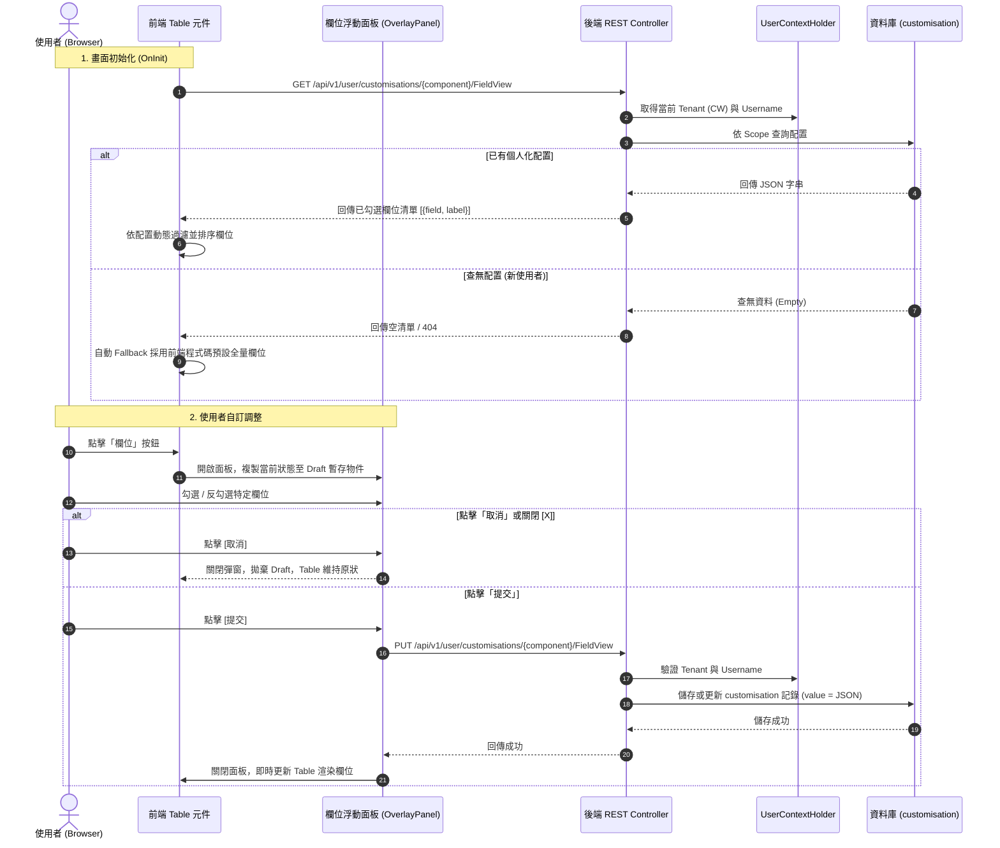

# 表格欄位個人化顯示配置設計規格書 (Table Column Customisation Design)

本文件定義 `setting-module` 中 **個人化配置子模組 (Personalisation / Customisation Submodule)** 的架構設計、領域模型、資料庫綱要與前後端協同規範，優先聚焦於 **「表格欄位個人化顯示 (Table Column Customisation / FieldView)」**。

---

## 1. 業務背景與核心價值 (Background & Business Value)

在企業級後台管理系統（如系統配置、群組維護、角色管理、訂單明細等）中，單一業務表格往往包含數十個欄位（例如：代碼、名稱、分類、描述、建立者、建立時間、更新時間、狀態、操作等）。

不同角色或個別使用者的業務關注點大不相同：
* **業務營運人員**：只關注「名稱、分類、數值、是否有效」，繁雜的「代碼、更新時間、流水號」會造成介面資訊過載。
* **技術維運人員**：需要看到「代碼、系統參數、最後異動時間」以利除錯。

### 解決方案
提供 **「欄位個人化自訂機制」**：
1. **自由勾選顯示/隱藏**：使用者點擊表格工具列上的「欄位」按鈕，即可開啟浮動面板勾選想要呈現的欄位。
2. **前後順序記憶**：自訂欄位排列先後順序。
3. **雲端持久化儲存**：透過後端 API 將配置綁定至特定使用者帳號，更換裝置、瀏覽器或重新登入時依然保留個人偏好。
4. **優雅回退 (Graceful Fallback)**：新使用者若尚未設定，自動回退使用前端預設的全量欄位佈局。

---

## 2. 前端使用者體驗與互動流程 (UX & Interaction Flow)

### 2.1 介面互動視覺
在表格工具列（Toolbar）提供「欄位」操作入口，點擊觸發 PrimeNG `p-overlayPanel` 浮動彈窗：

```text
[表格工具列]
  + 新增設定    ⊕ 批次匯出    Y 欄位 (點擊開啟彈窗)
                             │
                             ▼
              ┌─────────────────────────────────┐
              │ 欄位設定                    [✕] │
              ├─────────────────────────────────┤
              │ [✓] 服務                        │
              │ [✓] 配置種類                    │
              │ [✓] 群組代碼                    │
              │ [✓] 名稱                        │
              │ [ ] 說明  <-- 使用者取消勾選     │
              │ [✓] 生效                        │
              ├─────────────────────────────────┤
              │      [ 提交 ]      [ 取消 ]     │
              └─────────────────────────────────┘
```

### 2.2 循序圖 (Sequence Diagram)



---

## 3. 資料庫設計與 Entity 模型

### 3.1 資料庫綱要 (DDL)

```sql
CREATE TABLE customisation (
    id BIGINT AUTO_INCREMENT PRIMARY KEY COMMENT '流水號主鍵',
    tenant VARCHAR(50) NOT NULL COMMENT '所屬租戶 (如 CW, ALL)',
    username VARCHAR(100) NOT NULL COMMENT '使用者帳號',
    component VARCHAR(100) NOT NULL COMMENT '前端 Component 名稱 (如 SettingComponent)',
    type VARCHAR(50) NOT NULL COMMENT '偏好種類 (如 FieldView, FilterView)',
    value TEXT NOT NULL COMMENT '偏好設定內容 (JSON 字串)',
    active_flag VARCHAR(1) NOT NULL DEFAULT 'Y' COMMENT '有效性標記 (Y/N)',
    created_date DATETIME(6) NULL COMMENT '建立時間',
    last_modified_date DATETIME(6) NULL COMMENT '最後修改時間',
    CONSTRAINT uk_customisation_scope UNIQUE (tenant, username, component, type),
    INDEX idx_customisation_lookup (tenant, username, component)
) ENGINE=InnoDB DEFAULT CHARSET=utf8mb4 COMMENT='使用者介面個人化配置表';
```

---

### 3.2 領域聚合根 (Aggregate Root)：`Customisation.java`

```java
package com.module.setting.domain.model.customisation;

import com.module.setting.domain.model.common.YesNo;
import jakarta.persistence.*;
import lombok.AccessLevel;
import lombok.Getter;
import lombok.NoArgsConstructor;
import lombok.ToString;
import org.springframework.data.annotation.CreatedDate;
import org.springframework.data.annotation.LastModifiedDate;
import org.springframework.data.jpa.domain.support.AuditingEntityListener;

import java.time.LocalDateTime;

/**
 * 個人化配置 Aggregate Root
 */
@Entity
@Getter
@ToString
@Table(
    name = "customisation",
    uniqueConstraints = {
        @UniqueConstraint(
            name = "uk_customisation_scope",
            columnNames = { "tenant", "username", "component", "type" }
        )
    },
    indexes = {
        @Index(name = "idx_customisation_lookup", columnNames = { "tenant", "username", "component" })
    }
)
@EntityListeners(AuditingEntityListener.class)
@NoArgsConstructor(access = AccessLevel.PROTECTED)
public class Customisation {

    @Id
    @GeneratedValue(strategy = GenerationType.IDENTITY)
    private Long id;

    @Embedded
    private CustomisationScope scope;

    @Column(name = "value", columnDefinition = "TEXT", nullable = false)
    private String value; // 儲存 JSON 字串，例如: [{"field":"service","label":"服務"}, ...]

    @Enumerated(EnumType.STRING)
    @Column(name = "active_flag", length = 1, nullable = false)
    private YesNo activeFlag = YesNo.Y;

    @CreatedDate
    @Column(name = "created_date", updatable = false)
    private LocalDateTime createdDate;

    @LastModifiedDate
    @Column(name = "last_modified_date")
    private LocalDateTime lastModifiedDate;

    /**
     * 領域工廠方法：建立個人化配置
     */
    public static Customisation create(CustomisationScope scope, String value) {
        Customisation customisation = new Customisation();
        customisation.scope = scope;
        customisation.value = value;
        customisation.activeFlag = YesNo.Y;
        return customisation;
    }

    /**
     * 領域業務行為：更新配置值 (使用者點擊提交儲存時)
     */
    public void updateValue(String newValue) {
        this.value = newValue;
    }

    /**
     * 領域業務行為：邏輯刪除 / 停用
     */
    public void delete() {
        this.activeFlag = YesNo.N;
    }

    /**
     * 領域業務行為：重新啟用
     */
    public void activate() {
        this.activeFlag = YesNo.Y;
    }
}
```

---

### 3.3 業務自然鍵坐標：`CustomisationScope.java`

```java
package com.module.setting.domain.model.customisation;

import jakarta.persistence.Column;
import jakarta.persistence.Embeddable;
import lombok.AccessLevel;
import lombok.EqualsAndHashCode;
import lombok.Getter;
import lombok.NoArgsConstructor;
import lombok.ToString;

import java.io.Serializable;

/**
 * 個人化配置範圍 (業務自然鍵坐標)
 */
@Getter
@Embeddable
@ToString
@EqualsAndHashCode
@NoArgsConstructor(access = AccessLevel.PROTECTED)
public class CustomisationScope implements Serializable {

    @Column(name = "tenant", length = 50, nullable = false)
    private String tenant;     // 所屬租戶 (如 "CW", "ALL")

    @Column(name = "username", length = 100, nullable = false)
    private String username;   // 使用者帳號 (如 "nickgh.zhang@cw.com")

    @Column(name = "component", length = 100, nullable = false)
    private String component;  // 前端 Component 名稱 (如 "SettingComponent")

    @Column(name = "type", length = 50, nullable = false)
    private String type;       // 偏好種類 (如 "FieldView", "FilterView")

    /**
     * 專用工廠方法：建立表格欄位偏好 (type 預設為 FieldView)
     */
    public static CustomisationScope ofFieldView(String tenant, String username, String component) {
        return of(tenant, username, component, "FieldView");
    }

    /**
     * 通用工廠方法
     */
    public static CustomisationScope of(String tenant, String username, String component, String type) {
        CustomisationScope scope = new CustomisationScope();
        scope.tenant = tenant;
        scope.username = username;
        scope.component = component;
        scope.type = type;
        return scope;
    }
}
```

---

## 4. 關鍵設計解析與評估

### 4.1 為什麼需要 `type` 欄位？(架構擴展性評估)
在實務資料庫中，雖然目前所有記錄的 `type` 皆為 `"FieldView"`，但保留此欄位至關重要：
1. **單表支撐多種 UI 偏好 (避免開新表)**：
   未來若系統需要為同一個 Component 增加「儲存預設篩選條件 (`FilterView`)」或「記憶分頁筆數 (`PageSize`)」，此資料庫結構可直接無痛複用，不需新增額外資料表。
2. **唯一性約束完整度**：
   `uk_customisation_scope (tenant, username, component, type)` 確保同一個使用者在同一元件下，能各自持有一份獨立的 `FieldView` 與 `FilterView`。
3. **呼叫端透明化**：
   透過提供 `CustomisationScope.ofFieldView(...)`，業務呼叫端無需手動硬編碼傳入字串，程式碼乾淨且型別安全。

### 4.2 `value` 欄位的逗號分隔 (CSV) 結構設計精華
`value` 欄位儲存格式範例：
```text
tenant,category,code,name,value
```

> **設計優勢**：
> 1. **「極度輕量」**：體積僅 50~100 bytes，傳輸與解析速度極快。
> 2. **「徹底解耦 UI 文案 (Label)」**：資料庫僅忠實記錄「欲顯示之欄位代碼 (field) 與順序」。欄位顯示名稱永遠由前端畫面與多語系字典 (i18n) 即時取得，杜絕文案過期與語言錯亂。
> 3. **「順序保證」**：逗號分隔之先後順序即代表表格由左至右之顯示順序。

---

## 5. 後端 RESTful API 規格

所有 API 均整合現行 `UserContextFilter`，直接從 HTTP Request Header (`X-Tenant-Id`, `X-Username`) 安全解析身分，前端不需在路徑或 Body 重複傳入使用者帳號，杜絕越權風險。

### 5.1 查詢個人化配置
* **HTTP Method**：`GET`
* **路徑**：`/api/v1/user/customisations/{component}/{type}`
* **Header 範例**：
  ```http
  X-Tenant-Id: CW
  X-Username: nickgh.zhang@cw.com
  ```
* **範例路徑**：`/api/v1/user/customisations/SettingComponent/FieldView`
* **成功回應 (200 OK)**：
  ```json
  {
    "success": true,
    "data": [
      { "field": "category", "label": "大分類" },
      { "field": "code", "label": "設定代碼" },
      { "field": "name", "label": "顯示名稱" },
      { "field": "value", "label": "配置數值" }
    ],
    "message": "查詢成功"
  }
  ```
* **無記錄情境**：回傳 `200 OK` 且 `data: []`，前端自動採用元件程式碼之預設所有欄位。

---

### 5.2 儲存/更新個人化配置
* **HTTP Method**：`PUT`
* **路徑**：`/api/v1/user/customisations/{component}/{type}`
* **請求主體 (Request Body)**：
  ```json
  [
    { "field": "category", "label": "大分類" },
    { "field": "code", "label": "設定代碼" },
    { "field": "name", "label": "顯示名稱" },
    { "field": "value", "label": "配置數值" }
  ]
  ```
* **成功回應 (200 OK)**：
  ```json
  {
    "success": true,
    "data": [ ... ],
    "message": "個人化配置儲存成功"
  }
  ```

---

### 5.3 還原預設配置 (Reset to Default)
* **HTTP Method**：`DELETE`
* **路徑**：`/api/v1/user/customisations/{component}/{type}`
* **行為**：將該使用者的偏好記錄刪除或設為 `active_flag = 'N'`，下次載入時自動恢復系統初始預設佈局。

---

## 6. 前端實作與整合細節 (PrimeNG)

### 6.1 資料狀態管理
前端 Table 元件維護三組狀態：
1. **`allColumns: ColumnDefinition[]`**：系統原始支援之全量欄位定義（唯讀常數）。
2. **`visibleColumns: ColumnDefinition[]`**：目前 Table 實際渲染的欄位陣列（由後端 API 或預設值驅動）。
3. **`draftColumns: ColumnDefinition[]`**：彈窗開啟時的暫存副本，供使用者在浮動面板中勾選，點擊「提交」才覆蓋至 `visibleColumns`。

### 6.2 彈窗防呆與取消機制
* 點擊「欄位」按鈕開啟 `p-overlayPanel` 時，深拷貝（Deep Clone）當前可見欄位到 `draftColumns`。
* 若使用者中途取消或關閉面板，`draftColumns` 自動作廢，Table 不受任何影響。
* 點擊「提交」時，同時執行：
  1. 更新本機 `visibleColumns`，畫面即時響應。
  2. 呼叫 `PUT` API 非同步存檔。

---

## 7. 實作任務規劃 (Implementation Roadmap)

| 階段 | 任務內容 | 產出檔案 |
| :--- | :--- | :--- |
| **Phase 1** | **後端領域模型與持久層** | `Customisation.java`, `CustomisationScope.java`, `SpringDataCustomisationRepository.java` |
| **Phase 2** | **後端應用層與 API 端點** | `CustomisationApplicationService.java`, `CustomisationController.java`, 單元測試 |
| **Phase 3** | **前端共用偏好服務** | `customisation.service.ts`（封裝 GET/PUT/DELETE API 呼叫） |
| **Phase 4** | **表格元件整合** | `setting-management.component.html` (加入欄位按鈕與 OverlayPanel) 及動態欄位過濾 |
